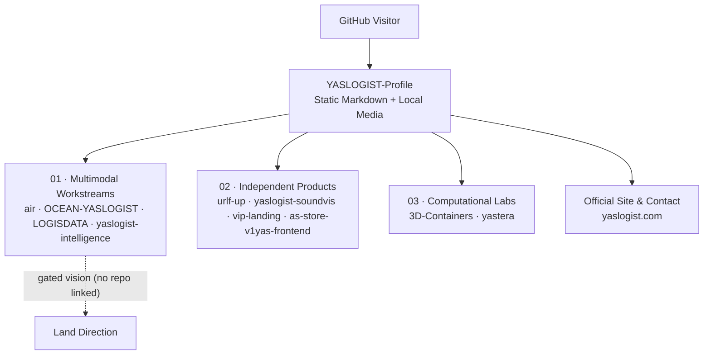
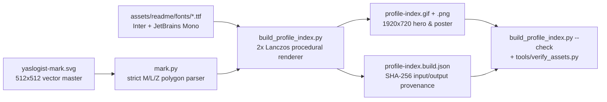

<div align="center">
  
</div>

<div align="center">

# YASLOGIST-Profile

**Self-verified public portfolio index mapping ten independent repositories across multimodal logistics, digital products, and computational labs.**

A public engineering portfolio by **[YASLOGIST](https://www.yaslogist.com)** · Cairo, Egypt

[Portfolio Index](#02--portfolio-index) · [Topology &amp; Provenance](#03--topology--provenance-flow) · [Tooling &amp; Validation](#04--repository-tooling--validation) · [Status &amp; Boundaries](#05--status--boundaries) · [yaslogist.com](https://www.yaslogist.com)

<sub>Pre-rendered schematic index — not live telemetry or a shared control room. Prefer reduced motion? <a href="./assets/readme/profile-index.png">Open the static poster (PNG)</a>.</sub>

</div>

---

## 01 / Orientation &amp; Quick Check

**`YASLOGIST-Profile`** is the organization-level entry point for public work published under [`github.com/YASLOGIST`](https://github.com/YASLOGIST). It indexes **ten standalone public repositories** across three domains without coupling them into a shared runtime, backend, API, or data bus. Inside this repository itself, Python build and verification scripts compile the profile's artwork from a single SVG brand-mark master, record SHA-256 input/output provenance stamps, and validate binary media structure and README asset integrity.

**Proof of life (standard library only, Python 3.11+, no package install required):**

```bash
git clone https://github.com/YASLOGIST/YASLOGIST-Profile.git
cd YASLOGIST-Profile
python3 tools/verify_assets.py
```

---

## 02 / Portfolio Index

Status labels below follow strict evidence boundaries:
- **`Present — unverified here`** — public repository and metadata verified on GitHub; implementation, setup, and runtime maturity live in that repository and are not executed or monitored by this profile.
- **`Planned / vision`** — directional workstream noted for context; no standalone public repository is linked here.

### 02.1 · Multimodal Workstreams (4 linked repositories + 1 directional slot)

| Repository | Stack | Public scope (from linked repository) | Listed homepage | Status from this repo |
| :--- | :--- | :--- | :--- | :--- |
| **[YASLOGIST Air](https://github.com/YASLOGIST/air)** | TypeScript | Air-freight simulation cockpit for cargo planning, ULD fit, and CAI corridors. | [air.yaslogist.me](https://air.yaslogist.me) | `Present — unverified here` |
| **[YASLOGIST Ocean](https://github.com/YASLOGIST/OCEAN-YASLOGIST)** | TypeScript | Sea-freight demo covering Egyptian gateways, cold-chain scenarios, and shipment handoffs. | [ocean.yaslogist.me](https://ocean.yaslogist.me) | `Present — unverified here` |
| **[LOGISDATA](https://github.com/YASLOGIST/LOGISDATA)** | TypeScript | Interactive supply-chain audit and data-reconciliation control room. | [logisdata.vercel.app](https://logisdata.vercel.app) | `Present — unverified here` |
| **[YASLOGIST Intelligence](https://github.com/YASLOGIST/yaslogist-intelligence)** | JavaScript | Regional threat and supply-chain intelligence dashboard. | [yaslogist-intelligence.vercel.app](https://yaslogist-intelligence.vercel.app) | `Present — unverified here` |
| **Land** *(corridor vision)* | — | Ground-operations direction within the multimodal thesis; shown in the hero as the gated dashed fifth cell on Rail `01`. | — | `Planned / vision` |

### 02.2 · Independent Products (4 linked repositories)

| Repository | Stack | Public scope (from linked repository) | Listed homepage | Status from this repo |
| :--- | :--- | :--- | :--- | :--- |
| **[UrLife](https://github.com/YASLOGIST/urlf-up)** | JavaScript | Collaboration platform concept connecting visionaries, builders, and enablers. | [urlf-up.vercel.app](https://urlf-up.vercel.app) | `Present — unverified here` |
| **[SOUNDVIS](https://github.com/YASLOGIST/yaslogist-soundvis)** | TypeScript | Audio-reactive 3D visualizer and live VJ performance engine. | — | `Present — unverified here` |
| **[VIP Motors Atelier](https://github.com/YASLOGIST/vip-landing)** | JavaScript | Bilingual luxury-vehicle concierge landing experience. | — | `Present — unverified here` |
| **[YAS Store](https://github.com/YASLOGIST/as-store-v1yas-frontend)** | JavaScript | Shopify Hydrogen storefront with edge rendering, search, and commerce flows. | — | `Present — unverified here` |

### 02.3 · Computational Labs (2 linked repositories)

| Repository | Stack | Public scope (from linked repository) | Listed homepage | Status from this repo |
| :--- | :--- | :--- | :--- | :--- |
| **[3D-Containers](https://github.com/YASLOGIST/3D-Containers)** | TypeScript | Browser-based procedural aviation ULD workbench (Three.js + React) with 17 modeled ULD types, envelope inspection, and client-side GLB, OBJ, and STL mesh export. | [containers-one.vercel.app](https://containers-one.vercel.app) | `Present — unverified here` |
| **[Orbital Earth](https://github.com/YASLOGIST/yastera)** | JavaScript | Real-time Three.js and GLSL ES 3.00 orbital Earth simulation with a four-layer planet, analytic single-scattering atmosphere, ocean optics, and city lighting without baked scene lights. | — | `Present — unverified here` |

> **Navigation &amp; demo boundary:** Listed homepages are declared on the respective repositories for convenience. This profile does not monitor external URLs, verify uptime, or assert commercial deployment, live operational feeds, or service-level guarantees.

---

## 03 / Topology &amp; Provenance Flow

### Portfolio Navigation (No Cross-Repository Runtime)

Edges below represent **documentation links from this README**, never runtime API calls or shared infrastructure:



### Build-Time Asset &amp; Verification Pipeline (Inside This Repository)

This repository has **no application runtime**. All Python code runs offline at author/CI time to synthesize deterministic media and verify committed files:



---

## 04 / Repository Tooling &amp; Validation

### Architecture &amp; File Inventory

| Layer | Implemented reality in `YASLOGIST-Profile` |
| :--- | :--- |
| **Display runtime** | GitHub Markdown/HTML/Mermaid renderer only. Zero JavaScript, external stylesheets, iframes, backends, databases, or package manifests (`package.json`, `pyproject.toml`, `requirements.txt` are intentionally absent). |
| **Configuration &amp; secrets** | None. No `.env` files, API keys, tokens, or runtime environment variables are consumed by the generators or verifiers. |
| **Vector brand master** | [`assets/readme/yaslogist-mark.svg`](./assets/readme/yaslogist-mark.svg) (`512 × 512` `viewBox`, ring `r=238`, `stroke-width=16`, two closed glyph outlines covering `16.1%` of the ring's box), parsed strictly by [`assets/readme/mark.py`](./assets/readme/mark.py) without third-party dependencies. |
| **Opening hero &amp; stamp** | [`assets/readme/build_profile_index.py`](./assets/readme/build_profile_index.py) renders [`profile-index.gif`](./assets/readme/profile-index.gif) (`1920 × 720`, `200` frames @ `50 ms` = `10.00 s` seamless loop, single 256-colour table, `477,676` bytes) and [`profile-index.png`](./assets/readme/profile-index.png) (`1920 × 720`, `162,926` bytes), plus [`profile-index.build.json`](./assets/readme/profile-index.build.json). |
| **Automated verification** | [`tools/verify_assets.py`](./tools/verify_assets.py) checks README local asset references, orphan media files, binary GIF89a/PNG headers, mark geometry, build stamps, and (with `--strict`) frame decode, luminance smoothness, and loop-seam continuity. [`tests/`](./tests) holds `39` `unittest` cases; `.github/workflows/verify.yml` runs on Python `3.11` and `3.12`. |

```text
README.md                               portfolio index, architecture, and verification guide
assets/readme/profile-index.gif         animated schematic hero (1920x720, 200f @ 50ms, 10.0s)
assets/readme/profile-index.png         static equilibrium poster (1920x720, all 3 rails shown)
assets/readme/profile-index.build.json  SHA-256 provenance stamp for profile-index inputs/outputs
assets/readme/build_profile_index.py    procedural 2x-supersampled Pillow generator + --check
assets/readme/yaslogist-mark.svg        single-source-of-truth circular YL vector mark
assets/readme/mark.py                   dependency-free SVG M/L/Z polygon parser and area invariants
assets/readme/fonts/                    bundled Inter and JetBrains Mono TrueType faces
assets/readme/yaslogist-signature.png   closing brand signature banner (1200x190)
assets/readme/{scene,build_hero,build_poster}.py + yaslogist-hero.* + yaslogist-signal.gif
                                        retained generation-1 artwork & active verifier targets
assets/platform-map.svg                 retained static multimodal diagram plate
assets/yaslogist-{motion.gif,poster.png} retired legacy identity files (excluded by LEGACY_MEDIA)
tools/verify_assets.py                  README reference, orphan, binary GIF/PNG, and stamp verifier
tests/                                  mark geometry, scene-mark ink, and verifier unit tests
```

### Prerequisites &amp; Full Local Validation

- **Standard-library checks** require only **Python 3.11+** (matches CI matrix `3.11` / `3.12`).
- **Regenerating artwork and running `--strict` pixel checks** require `Pillow>=10,<14` and `numpy>=1.24,<3` in an isolated virtual environment (never committed to the repository):

```bash
python3 -m venv ~/.venvs/yaslogist-profile
. ~/.venvs/yaslogist-profile/bin/activate
python -m pip install "Pillow>=10,<14" "numpy>=1.24,<3"

# 1. Rebuild or verify the current portfolio-index hero, poster, and SHA-256 stamp
python assets/readme/build_profile_index.py --check
# (Run `python assets/readme/build_profile_index.py` without `--check` to regenerate.)

# 2. Run the full repository asset & README verifier (all 34 structural + pixel checks)
python tools/verify_assets.py --strict

# 3. Run unit tests, bytecode syntax check, and whitespace hygiene check
python -m unittest discover -s tests -t . -v
python -m py_compile \
  assets/readme/build_profile_index.py \
  assets/readme/build_hero.py \
  assets/readme/build_poster.py \
  assets/readme/scene.py \
  assets/readme/mark.py \
  tools/verify_assets.py
git diff --check
```

**Disclosed test &amp; CI limitations:**
1. **`test_profile_opens_with_static_art_and_opt_in_motion` (`tests/test_verify_assets.py`):** This pre-existing test asserts that the older static `./assets/readme/yaslogist-hero.webp` is the first `` in `README.md` and that no `.gif` appears in an `` tag. Under an animated-first hero (`./assets/readme/profile-index.gif`), `38` of `39` unit tests pass and this `1` test fails until `tests/test_verify_assets.py` is updated in a test-scoped change.
2. **Verifier coverage split:** `python tools/verify_assets.py --strict` verifies `README.md` asset resolution, orphan detection, link counts, mark geometry, and the retained `yaslogist-hero.*` assets (`34` checks passing, `0` warnings), while `python assets/readme/build_profile_index.py --check` separately verifies `profile-index.gif`, `profile-index.png`, and `profile-index.build.json`. `.github/workflows/verify.yml` does not yet invoke `build_profile_index.py --check` or byte-compile `build_profile_index.py`.
3. **Cross-machine rasterization:** FreeType glyph antialiasing and palette quantization can vary slightly across OS/Pillow builds; freshness is therefore enforced via SHA-256 input/output build stamps rather than cross-machine pixel equality.

<details>
<summary><strong>Measured properties of the opening hero (<code>profile-index.gif</code> &amp; <code>profile-index.png</code>)</strong></summary>

| Metric | Measured value |
| :--- | :--- |
| Canvas &amp; safe inset | `1920 × 720 px` (`2×` supersampled at `3840 × 1440`, Lanczos downsampled); all text, symbols, and tiles inside the `5%` safe inset (`[96..1824] × [36..684]`) |
| Typography scale &amp; WCAG contrast | Primary lockup `100 px` (`Inter-ExtraBold`); secondary labels `36–42 px` (`Inter-SemiBold`, `JetBrains Mono`); measured WCAG 2.1 contrast `8.20:1` to `16.93:1` against plate backgrounds |
| Animation loop &amp; cadence | `GIF89a`, `200` decoded frames @ uniform `50 ms/frame` = **`10.00 s`**, `NETSCAPE2.0` `loop=0` (infinite), single shared `256`-colour global table (`dither=NONE`) |
| Motion smoothness &amp; seam | Median `0.057%` changed pixels/step, peak `1.856%`, wrap-around seam `0.035%` (`frame[199] → frame[0]`), max global brightness step `0.250 / 255` (`< 3 Hz` flash threshold) |
| Byte size | Animated GIF: **`477,676` bytes** (`466.5 KiB`); static PNG poster: **`162,926` bytes** (`159.1 KiB`) |
| Reduced-motion fallback | [`profile-index.png`](./assets/readme/profile-index.png) renders all three rails (`01 Multimodal`, `02 Products`, `03 Labs`) simultaneously at balanced illumination so no meaning depends on animation |

</details>

<details>
<summary><strong>Retained generation-1 artwork &amp; verifier targets</strong></summary>

Earlier repository iterations shipped an illustrative orthographic globe hero and multimodal plate that remain committed because `tools/verify_assets.py` and `tests/test_verify_assets.py` directly inspect their headers, build stamp, and orphan status:

- **Generation-1 globe media:** [`yaslogist-hero.gif`](./assets/readme/yaslogist-hero.gif) (`1920 × 720`, `200` frames @ `50 ms`, `10,205,727` bytes), [`yaslogist-hero.png`](./assets/readme/yaslogist-hero.png) (`1,424,508` bytes), and [`yaslogist-hero.webp`](./assets/readme/yaslogist-hero.webp) (`140,126` bytes, XMP-linked to the PNG SHA-256), built by [`scene.py`](./assets/readme/scene.py), [`build_hero.py`](./assets/readme/build_hero.py), and [`build_poster.py`](./assets/readme/build_poster.py) with provenance in [`yaslogist-hero.build.json`](./assets/readme/yaslogist-hero.build.json).
- **Supporting plates:** [`yaslogist-signal.gif`](./assets/readme/yaslogist-signal.gif) (`1200 × 30` animated divider) and [`assets/platform-map.svg`](./assets/platform-map.svg) (`1200 × 348` static Land / Ocean / Air / Data schematic). All routes and labels in these retained files are conceptual portfolio illustrations, not live operational feeds.

</details>

---

## 05 / Status &amp; Boundaries

| Classification | Scope in `YASLOGIST-Profile` |
| :--- | :--- |
| **`Implemented — verified`** | Root `README.md`, procedural portfolio-index artwork (`profile-index.gif`, `profile-index.png`, `profile-index.build.json`, `build_profile_index.py`), single-source SVG mark geometry (`yaslogist-mark.svg`, `mark.py`), retained generation-1 media, and `tools/verify_assets.py` (`34/34` checks passing with `--strict`). |
| **`Present — unverified here`** | All ten linked public repositories under [`github.com/YASLOGIST`](https://github.com/YASLOGIST) and their listed demo URLs; also `.github/workflows/verify.yml` execution on remote runners (inspected locally, not triggered in this session). |
| **`Planned / vision`** | **Land** as a standalone multimodal workstream (represented as the gated dashed fifth module on Rail `01`; no standalone repository linked). |
| **`Not asserted`** | Live telemetry, real-time shipment tracking, cross-project software integration, commercial production SLAs, security certifications, customer metrics, or guaranteed external demo uptime. |

### Contributing &amp; Maintenance Notes

When updating `README.md` or anything under `assets/readme/`, keep every local media reference resolving cleanly, rebuild the corresponding `.build.json` provenance stamp (`python assets/readme/build_profile_index.py`), and run both `python assets/readme/build_profile_index.py --check` and `python tools/verify_assets.py --strict` before opening a pull request.

---

<div align="center">
  <a href="https://www.yaslogist.com" title="Visit the official YASLOGIST website">
    
  </a>
  <br />
  <a href="https://www.yaslogist.com">Official website</a> ·
  <a href="https://github.com/YASLOGIST?tab=repositories">Public repositories</a> ·
  <a href="mailto:support@yaslogist.com">support@yaslogist.com</a>
  <br /><br />
  <b>YASLOGIST</b> · <sub>MOVE SMARTER. SEE FURTHER. · Cairo, Egypt</sub>
</div>
