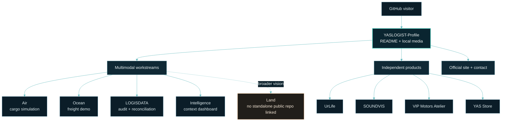

<div align="center">
  
  <br />
  
</div>

<div align="center">

**MOVE SMARTER. SEE FURTHER.**<br />
<sub>YASLOGIST · ENGINEERING &amp; DIGITAL PRODUCTS · CAIRO, EGYPT</sub>

<sub><a href="./assets/readme/yaslogist-hero.png">Open the static hero poster</a> · The route artwork is a schematic of the public portfolio, not live logistics data.</sub>

</div>

---

## 01 / THE SYSTEM

**YASLOGIST** is a Cairo-based engineering and digital-products portfolio. Its logistics work explores the connections between **land, ocean, air, data, visibility, and intelligence**. Each public workstream keeps its own project identity; independent products remain distinct under the YASLOGIST engineering umbrella.

This repository is the **GitHub organization profile**: a curated entry point to that work, not a single logistics application or an operational control room. Public demonstrations and project descriptions are not evidence of live feeds, commercial deployment, or production integrations.

<details>
<summary><strong>How the hero artwork is built</strong></summary>

The opening visual is a **pre-rendered motion piece**, generated procedurally by the tooling in this repository rather than assembled from third-party imagery:

| Property | Value |
| :--- | :--- |
| Master composition | 1920 × 720, 200 frames, 50 ms per frame (**10.0 s**), seamless loop |
| Format | GIF89a, **one 256-colour palette shared by all frames** — GitHub displays it with **no JavaScript, no video player, no external hosting** |
| Size | ≈ 9.7 MB (single file, served from this repository) |
| Static fallback | [`yaslogist-hero.png`](./assets/readme/yaslogist-hero.png) |
| Generator | [`assets/readme/build_hero.py`](./assets/readme/build_hero.py) + [`assets/readme/scene.py`](./assets/readme/scene.py) |
| Brand mark | Drawn directly from the path geometry of [`yaslogist-mark.svg`](./assets/readme/yaslogist-mark.svg) — the official YL mark, not a redrawn approximation |
| Type | Inter and JetBrains Mono, bundled in [`assets/readme/fonts/`](./assets/readme/fonts) |

Every animated element is periodic over the loop, and expanding pulses are damped to zero at the seam, so the composition returns to its opening state with no visible cut. The result is verified by direct inspection of rendered frames.

</details>

## 02 / MULTIMODAL WORKSTREAMS

| Workstream | Primary stack | Public scope |
| :--- | :--- | :--- |
| **Air — [YASLOGIST Air](https://github.com/YASLOGIST/air)** | TypeScript | Air-freight simulation cockpit for cargo planning, ULD fit, and CAI corridors. |
| **Ocean — [YASLOGIST Ocean](https://github.com/YASLOGIST/OCEAN-YASLOGIST)** | TypeScript | Sea-freight demo spanning Egyptian gateways, cold-chain scenarios, and shipment handoffs. |
| **Data — [LOGISDATA](https://github.com/YASLOGIST/LOGISDATA)** | TypeScript | Interactive supply-chain audit and data-reconciliation control room. |
| **Intelligence — [YASLOGIST Intelligence](https://github.com/YASLOGIST/yaslogist-intelligence)** | JavaScript | Regional threat and supply-chain intelligence dashboard. |
| **Land — platform vision** | — | Part of the broader multimodal direction; no standalone Land repository is linked from this profile. |

## 03 / INDEPENDENT PRODUCTS

Distinct product identities, developed alongside the logistics work:

| Product | Primary stack | Focus |
| :--- | :--- | :--- |
| **[UrLife](https://github.com/YASLOGIST/urlf-up)** | JavaScript | Collaboration platform concept connecting visionaries, builders, and enablers. |
| **[SOUNDVIS](https://github.com/YASLOGIST/yaslogist-soundvis)** | TypeScript | Audio-reactive 3D visualizer and live VJ performance engine. |
| **[VIP Motors Atelier](https://github.com/YASLOGIST/vip-landing)** | JavaScript | Bilingual luxury-vehicle concierge landing experience. |
| **[YAS Store](https://github.com/YASLOGIST/as-store-v1yas-frontend)** | JavaScript | Shopify Hydrogen storefront with edge rendering, search, and commerce flows. |

## 04 / SYSTEM BLUEPRINT

This diagram describes the **portfolio and its navigation**, not a shared runtime architecture. The linked repositories may have their own implementations and deployment models.



## 05 / HOW TO EXPLORE

1. **Choose a workstream or product** above.
2. **Open its repository** for source, project-specific setup, and current maturity.
3. **Use the YASLOGIST site or email** for organization-level information.

The links in this profile are navigation only. This repository does not call project APIs, ingest shipment events, or combine the linked projects into one running service.

## 06 / PROFILE REPOSITORY

| Layer | What is actually here |
| :--- | :--- |
| **Content** | `README.md`, GitHub Flavored Markdown, supported HTML for image layout, and Mermaid. |
| **Media** | Local GIF, PNG, and SVG artwork; the hero is pre-rendered so GitHub needs no JavaScript or video player. |
| **Rendering** | GitHub's organization-profile README renderer. There is no browser application or backend in this repository. |
| **Runtime / deployment** | No application runtime, package manifest, API, database, or separate deployment pipeline is defined here. GitHub renders the profile directly. |
| **Tests / CI** | No automated test suite or CI workflow is present. See *verified by inspection* below. |

The hero master and static poster are **1920 × 720**. `assets/readme/build_hero.py` is an optional asset-generation tool; it is not part of the profile's runtime.

<details>
<summary><strong>Verified by inspection</strong></summary>

Checked directly against the committed files, not asserted from documentation:

| Check | Result |
| :--- | :--- |
| Hero decodes | 200 frames read, GIF89a, trailer intact, no corrupt or blank frames |
| Frame rate | 20 fps effective; consecutive-frame luminance step never exceeds 0.8/255, so there is no flicker |
| Hero geometry | 1920 × 720, 50 ms per frame, 10.0 s total, infinite loop (`loop=0`) |
| Palette | All 200 frames carry a byte-identical 256-colour table — one shared palette in effect |
| Loop continuity | The `frame[199] → frame[0]` step changes **fewer** pixels than a typical mid-loop step, so the loop reads as continuous |
| Poster fallback | 1920 × 720 RGB, committed alongside the animation |
| Glyph quality | The wordmark was compared against the uncompressed render at 3× magnification; no distortion |
| Brand mark | Hero geometry is drawn from `yaslogist-mark.svg`, the official YL mark |
| Asset paths | Every asset reference in this README resolves to a committed file |
| Linked projects | All eight linked repositories were checked against the live organization listing, and languages shown here match |

Motion, palette and file size were balanced against each other: the art direction was tuned for motion economy rather than quality being traded away for bytes. The file sits just under 10 MB.

</details>

<details>
<summary><strong>Regenerating the artwork</strong></summary>

The motion is baked into local GIFs for reliable GitHub display. To rebuild it, use Python 3 with Pillow and NumPy:

```bash
python3 -m venv ~/.venvs/yaslogist-readme
~/.venvs/yaslogist-readme/bin/python -m pip install Pillow numpy
~/.venvs/yaslogist-readme/bin/python assets/readme/build_hero.py
```

`build_hero.py` writes only to `assets/readme/`, needs no network access, and uses Pillow's own GIF encoder — there is no ImageMagick or other external post-processing step, because re-quantising an already-optimal GIF risks damaging the letterforms for a marginal gain. Fonts are committed under `assets/readme/fonts/`, so the build is reproducible offline. The virtual environment is local build tooling only; the profile renderer does not use it.

Encoding size is dominated by *how much of the frame changes per second*, not by the palette. If you need a smaller file, the honest levers are `FRAMES` and `DELAY_MS` in `assets/readme/scene.py` — reducing frames lowers the frame rate and the byte count together. Palette colour count is **not** a good lever here: dropping to 128 colours measurably speckled the wordmark while saving under 3%.

Useful local checks:

```bash
python3 -m py_compile assets/readme/build_hero.py assets/readme/scene.py
~/.venvs/yaslogist-readme/bin/python -c "from PIL import Image; im = Image.open('assets/readme/yaslogist-hero.gif'); print(im.size, im.n_frames, 'frames', im.info['duration'], 'ms', im.n_frames * im.info['duration'] / 1000, 's')"
git diff --check
```

No product dependencies are added by this generator. [`yaslogist-mark.svg`](./assets/readme/yaslogist-mark.svg) is the standalone vector master for the circular YL mark used in the hero and closing signature.

</details>

## 07 / STATUS &amp; SCOPE

- **Implemented here:** organization-profile content and locally stored visual assets.
- **Public project scope:** described by each linked repository; consult that repository for its current code and maturity.
- **Broader direction:** Land is represented as part of the platform vision, not as a standalone public workstream in this profile.
- **Not asserted by this README:** live operational feeds, production service levels, commercial deployment, or integrations between projects.

<div align="center">
  
</div>

## 08 / YASLOGIST

<div align="center">
  <a href="https://www.yaslogist.com" title="Visit the official YASLOGIST website">
    
  </a>
  <br />
  <a href="https://www.yaslogist.com">Official website</a> ·
  <a href="https://github.com/YASLOGIST?tab=repositories">Public repositories</a> ·
  <a href="mailto:support@yaslogist.com">Email YASLOGIST</a>
  <br />
  <br />
  <b>YASLOGIST</b><br />
  <sub>MOVE SMARTER. SEE FURTHER.</sub><br />
  <sub>Independent engineering and digital products · Cairo, Egypt</sub>
</div>
