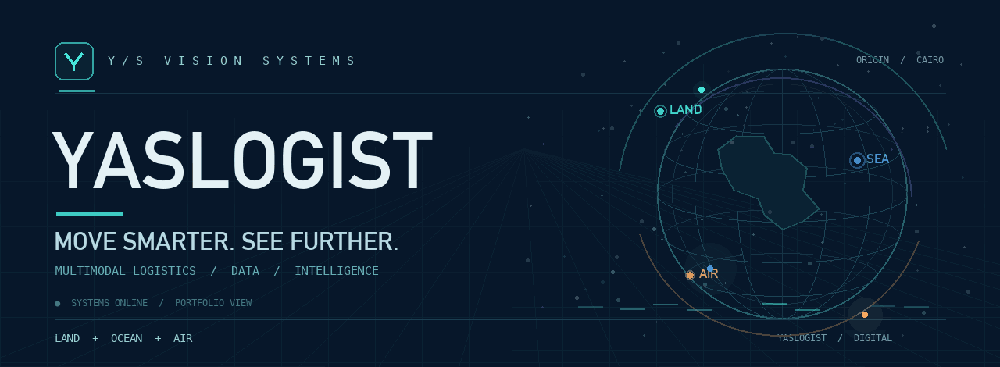

 

**Engineering the connections between movement, information, and decisions.**

[Official website](https://www.yaslogist.com) · [About YASLOGIST](https://www.yaslogist.com/about) · [Public repositories](https://github.com/YASLOGIST?tab=repositories) · [Contact](mailto:support@yaslogist.com)

YASLOGIST · Cairo, Egypt · Multimodal logistics intelligence &amp; independent digital products

---

### 01 / THE MISSION

**Move smarter. See further.**

YASLOGIST is building an interconnected approach to logistics visibility: **land, ocean, air, data, and intelligence**, designed to make complex movement easier to understand. Alongside that central mission, we build independent software products and creative digital experiences.

Our work connects operational thinking with clear interfaces, strong engineering foundations, and purposeful visual design.

  

### 02 / THE CORE NETWORK

<table>
<tr>
<td width="50%" valign="top">

**✈ [AIR / FREIGHT SYSTEMS](https://github.com/YASLOGIST/air)**

Air-cargo planning concepts, ULD fit, corridor views, and a visual operations cockpit.

AIR CARGO · PLANNING · VISUAL SYSTEMS

</td>
<td width="50%" valign="top">

**◈ [OCEAN / MARITIME SYSTEMS](https://github.com/YASLOGIST/OCEAN-YASLOGIST)**

Maritime demonstration scenarios spanning gateways, cold chain, and shipment handoffs.

MARITIME · COLD CHAIN · HANDOFFS

</td>
</tr>
<tr>
<td valign="top">

**▣ [LOGISDATA / RECONCILIATION](https://github.com/YASLOGIST/LOGISDATA)**

An interactive control-room concept for supply-chain auditing and data reconciliation.

DATA QUALITY · RECONCILIATION · ANALYTICS

</td>
<td valign="top">

**◇ [INTELLIGENCE / RISK &amp; VISIBILITY](https://github.com/YASLOGIST/yaslogist-intelligence)**

A regional intelligence dashboard exploring threat signals and supply-chain context.

INTELLIGENCE · RISK CONTEXT · DASHBOARDS

</td>
</tr>
</table>

<strong>LAND</strong> is part of the broader platform vision. Not every workstream or prototype is published publicly.

### 03 / INDEPENDENT PRODUCTS &amp; CREATIVE SYSTEMS

Different products. Distinct identities. One engineering umbrella.

| Product | Focus |
| :--- | :--- |
| **[UrLife](https://github.com/YASLOGIST/urlf-up)** | A collaboration platform concept connecting visionaries, builders, and enablers. |
| **[SOUNDVIS](https://github.com/YASLOGIST/yaslogist-soundvis)** | An audio-reactive 3D visual engine for live visual performance. |
| **[VIP Motors Atelier](https://github.com/YASLOGIST/vip-landing)** | A bilingual luxury automotive concierge experience. |
| **[YAS Store](https://github.com/YASLOGIST/as-store-v1yas-frontend)** | A storefront built around Shopify Hydrogen and modern commerce interfaces. |

These are **independent product and experience identities** developed under the YASLOGIST umbrella—not alternate names for the logistics platform.

### 04 / HOW WE THINK

<table>
<tr>
<td width="33%" valign="top"><strong>01 — SYSTEMS FIRST</strong> Clarity in structure, purpose, and information flow.</td>
<td width="33%" valign="top"><strong>02 — DESIGN WITH INTENT</strong> Interactions that explain, guide, and perform.</td>
<td width="33%" valign="top"><strong>03 — BUILT TO EVOLVE</strong> Room for modular growth and real-world constraints.</td>
</tr>
</table>

### 05 / EXPLORE &amp; CONNECT

[**VISIT YASLOGIST.COM ↗**](https://www.yaslogist.com) &nbsp;&nbsp;·&nbsp;&nbsp; [**VIEW ALL PUBLIC WORK ↗**](https://github.com/YASLOGIST?tab=repositories) &nbsp;&nbsp;·&nbsp;&nbsp; [**EMAIL ↗**](mailto:support@yaslogist.com)

Public repositories include demonstrations and illustrative product experiences; they should not be interpreted as proof of live operational feeds or commercially deployed functionality.

 

© YASLOGIST · Independent engineering and digital product portfolio · Cairo, Egypt

