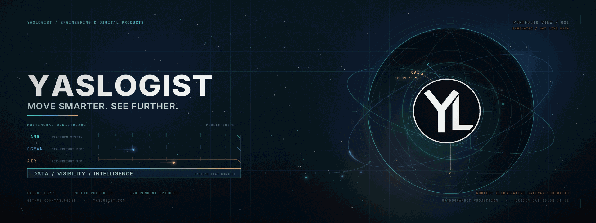
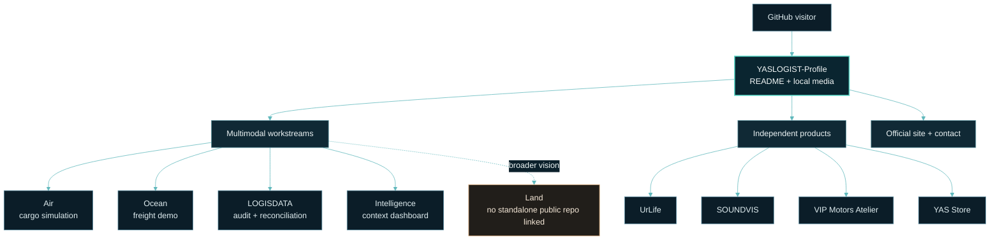

<div align="center">
  
  <br />
  
</div>

<div align="center">

**MOVE SMARTER. SEE FURTHER.**<br />
<sub>YASLOGIST · ENGINEERING &amp; DIGITAL PRODUCTS · CAIRO, EGYPT</sub>

<sub><a href="./assets/readme/yaslogist-hero.png">Open the static hero poster</a> · The route artwork is illustrative, not live logistics data.</sub>

</div>

---

## 01 / THE SYSTEM

**YASLOGIST** is a Cairo-based engineering and digital-products portfolio. Its logistics work explores the connections between **land, ocean, air, data, visibility, and intelligence**. Each public workstream keeps its own project identity; independent products remain distinct under the YASLOGIST engineering umbrella.

This repository is the **GitHub organization profile**: a curated entry point to that work, not a single logistics application or an operational control room. Public demonstrations and project descriptions are not evidence of live feeds, commercial deployment, or production integrations.

## 02 / MULTIMODAL WORKSTREAMS

| Workstream | Public scope |
| :--- | :--- |
| **Air — [YASLOGIST Air](https://github.com/YASLOGIST/air)** | Air-freight simulation cockpit for cargo planning, ULD fit, and CAI corridors. |
| **Ocean — [YASLOGIST Ocean](https://github.com/YASLOGIST/OCEAN-YASLOGIST)** | Sea-freight demo spanning Egyptian gateways, cold-chain scenarios, and shipment handoffs. |
| **Data — [LOGISDATA](https://github.com/YASLOGIST/LOGISDATA)** | Interactive supply-chain audit and data-reconciliation control room. |
| **Intelligence — [YASLOGIST Intelligence](https://github.com/YASLOGIST/yaslogist-intelligence)** | Regional threat and supply-chain intelligence dashboard. |
| **Land — platform vision** | Part of the broader multimodal direction; no standalone Land repository is linked from this profile. |

## 03 / INDEPENDENT PRODUCTS

Distinct product identities, developed alongside the logistics work:

| Product | Focus |
| :--- | :--- |
| **[UrLife](https://github.com/YASLOGIST/urlf-up)** | Collaboration platform concept connecting visionaries, builders, and enablers. |
| **[SOUNDVIS](https://github.com/YASLOGIST/yaslogist-soundvis)** | Audio-reactive 3D visualizer and live VJ performance engine. |
| **[VIP Motors Atelier](https://github.com/YASLOGIST/vip-landing)** | Bilingual luxury-vehicle concierge landing experience. |
| **[YAS Store](https://github.com/YASLOGIST/as-store-v1yas-frontend)** | Shopify Hydrogen storefront with edge rendering, search, and commerce flows. |

## 04 / SYSTEM BLUEPRINT

This diagram describes the **portfolio and its navigation**, not a shared runtime architecture. The linked repositories may have their own implementations and deployment models.



## 05 / HOW TO EXPLORE

1. **Choose a workstream or product** above.
2. **Open its repository** for source, project-specific setup, and current maturity.
3. **Use the YASLOGIST site or email** for organization-level information.

The links in this profile are navigation only. This repository does not call project APIs, ingest shipment events, or combine the linked projects into one running service.

## 06 / PROFILE REPOSITORY

| Layer | What is actually here |
| :--- | :--- |
| **Content** | `README.md`, GitHub Flavored Markdown, supported HTML for image layout, and Mermaid. |
| **Media** | Local GIF, PNG, and SVG artwork; the hero is pre-rendered so GitHub needs no JavaScript or video player. |
| **Rendering** | GitHub's organization-profile README renderer. There is no browser application or backend in this repository. |
| **Runtime / deployment** | No application runtime, package manifest, API, database, or separate deployment pipeline is defined here. GitHub renders the profile directly. |
| **Tests / CI** | No automated test suite or CI workflow is present. GIF dimensions/decoding and local media paths were validated; linked public GitHub repositories were checked against the organization list. |

The hero master and static poster are **1920 × 720**. `assets/readme/build_hero.py` is an optional asset-generation tool; it is not part of the profile's runtime.

<details>
<summary><strong>Asset production and maintenance</strong></summary>

The motion is baked into local GIFs for reliable GitHub display. To regenerate the artwork, use Python 3, ImageMagick (`convert`), and Pillow:

```bash
python3 -m venv ~/.venvs/yaslogist-readme
~/.venvs/yaslogist-readme/bin/python -m pip install Pillow
~/.venvs/yaslogist-readme/bin/python assets/readme/build_hero.py
```

`convert` from ImageMagick must also be available on `PATH`. The virtual environment is local build tooling only; the profile renderer does not use it.

Useful local checks:

```bash
python3 -m py_compile assets/readme/build_hero.py
git diff --check
identify assets/readme/yaslogist-hero.gif assets/readme/yaslogist-hero.png
```

No product dependencies are added by this generator. [`yaslogist-mark.svg`](./assets/readme/yaslogist-mark.svg) is the standalone vector master for the circular YL mark used in the hero and closing signature.

</details>

## 07 / STATUS &amp; SCOPE

- **Implemented here:** organization-profile content and locally stored visual assets.
- **Public project scope:** described by each linked repository; consult that repository for its current code and maturity.
- **Broader direction:** Land is represented as part of the platform vision, not as a standalone public workstream in this profile.
- **Not asserted by this README:** live operational feeds, production service levels, commercial deployment, or integrations between projects.

## 08 / YASLOGIST

<div align="center">
  <a href="https://www.yaslogist.com" title="Visit the official YASLOGIST website">
    
  </a>
  <br />
  <a href="https://www.yaslogist.com">Official website</a> ·
  <a href="https://github.com/YASLOGIST?tab=repositories">Public repositories</a> ·
  <a href="mailto:support@yaslogist.com">Email YASLOGIST</a>
  <br />
  <sub>YASLOGIST · Independent engineering and digital products · Cairo, Egypt</sub>
</div>
