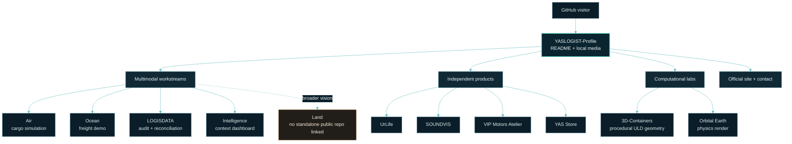
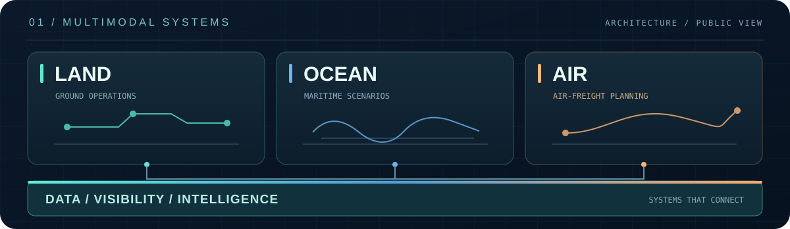

<div align="center">
  
  <br />
  
</div>

<div align="center">

**MOVE SMARTER. SEE FURTHER.**<br />
<sub>YASLOGIST · ENGINEERING &amp; DIGITAL PRODUCTS · CAIRO, EGYPT</sub>

<sub><a href="./assets/readme/yaslogist-hero.png">Open the static hero poster</a> · The route artwork is a schematic of the public portfolio, not live logistics data.</sub><br />
<sub>The moving hero is a pre-rendered 9.7 MiB GIF; on a slow connection the poster above is the same composition at 1.4 MiB.</sub>

</div>

---

## 01 / THE SYSTEM

**YASLOGIST** is a Cairo-based engineering and digital-products portfolio. Its logistics work explores the connections between **land, ocean, air, data, visibility, and intelligence**. Each public workstream keeps its own project identity; independent products remain distinct under the YASLOGIST engineering umbrella.

This repository is the **GitHub profile**: a curated entry point to that work, not a single logistics application or an operational control room. Public demonstrations and project descriptions are not evidence of live feeds, commercial deployment, or production integrations.

<details>
<summary><strong>How the hero artwork is built</strong></summary>

The opening visual is a **pre-rendered motion piece**, generated procedurally by the tooling in this repository rather than assembled from third-party imagery:

| Property | Value |
| :--- | :--- |
| Master composition | 1920 × 720, 200 frames, 50 ms per frame (**10.0 s**), seamless loop |
| Format | GIF89a, **one 256-colour palette shared by all frames** — GitHub displays it with **no JavaScript, no video player, no external hosting** |
| Size | 10,205,727 bytes ≈ 9.7 MiB (single file, served from this repository) |
| Static fallback | [`yaslogist-hero.png`](./assets/readme/yaslogist-hero.png) |
| Generator | [`assets/readme/build_hero.py`](./assets/readme/build_hero.py) + [`assets/readme/scene.py`](./assets/readme/scene.py) |
| Brand mark | Parsed at build time from [`yaslogist-mark.svg`](./assets/readme/yaslogist-mark.svg) by [`assets/readme/mark.py`](./assets/readme/mark.py) — the official YL mark, not a redrawn approximation and not a second copy of the coordinates |
| Type | Inter and JetBrains Mono, bundled in [`assets/readme/fonts/`](./assets/readme/fonts) |

Every animated element is periodic over the loop, and expanding pulses are damped to zero at the seam, so the composition returns to its opening state with no visible cut. The loop seam, palette and timing are re-checked from the committed file by `tools/verify_assets.py` on every push — see *Verified by automation* below.

</details>

## 02 / MULTIMODAL WORKSTREAMS

| Workstream | Primary stack | Public scope | Live demo |
| :--- | :--- | :--- | :--- |
| **Air — [YASLOGIST Air](https://github.com/YASLOGIST/air)** | TypeScript | Air-freight simulation cockpit for cargo planning, ULD fit, and CAI corridors. | [air.yaslogist.me](https://air.yaslogist.me) |
| **Ocean — [YASLOGIST Ocean](https://github.com/YASLOGIST/OCEAN-YASLOGIST)** | TypeScript | Sea-freight demo spanning Egyptian gateways, cold-chain scenarios, and shipment handoffs. | [ocean.yaslogist.me](https://ocean.yaslogist.me) |
| **Data — [LOGISDATA](https://github.com/YASLOGIST/LOGISDATA)** | TypeScript | Interactive supply-chain audit and data-reconciliation control room. | [logisdata.vercel.app](https://logisdata.vercel.app) |
| **Intelligence — [YASLOGIST Intelligence](https://github.com/YASLOGIST/yaslogist-intelligence)** | JavaScript | Regional threat and supply-chain intelligence dashboard. | [yaslogist-intelligence.vercel.app](https://yaslogist-intelligence.vercel.app) |
| **Land — platform vision** | — | Part of the broader multimodal direction; no standalone Land repository is linked from this profile. | — |

## 03 / INDEPENDENT PRODUCTS

Distinct product identities, developed alongside the logistics work:

| Product | Primary stack | Focus | Live demo |
| :--- | :--- | :--- | :--- |
| **[UrLife](https://github.com/YASLOGIST/urlf-up)** | JavaScript | Collaboration platform concept connecting visionaries, builders, and enablers. | [urlf-up.vercel.app](https://urlf-up.vercel.app) |
| **[SOUNDVIS](https://github.com/YASLOGIST/yaslogist-soundvis)** | TypeScript | Audio-reactive 3D visualizer and live VJ performance engine. | — |
| **[VIP Motors Atelier](https://github.com/YASLOGIST/vip-landing)** | JavaScript | Bilingual luxury-vehicle concierge landing experience. | — |
| **[YAS Store](https://github.com/YASLOGIST/as-store-v1yas-frontend)** | JavaScript | Shopify Hydrogen storefront with edge rendering, search, and commerce flows. | — |

## 04 / COMPUTATIONAL LABS

Two repositories push the same engineering surface — geometry, simulation, rendering — outside logistics. They are listed because they are public work, not because they are logistics products:

| Lab | Primary stack | Focus | Live demo |
| :--- | :--- | :--- | :--- |
| **[3D-Containers](https://github.com/YASLOGIST/3D-Containers)** | TypeScript | Browser-native procedural ULD geometry workbench: four IATA container families generated from 2D profiles, procedural PBR materials, and client-side `.glb` / `.obj` / `.stl` export. Unit-tested and CI-verified. | [containers-one.vercel.app](https://containers-one.vercel.app) |
| **[Orbital Earth](https://github.com/YASLOGIST/yastera)** | JavaScript | Physically based orbital Earth render: four-layer planet, single-scattering atmosphere, ocean optics, and city detail that resolves on descent — Three.js with hand-written GLSL and no baked lighting. | — |

Demo links above are the homepages each repository declares for itself. They are navigation only: this profile does not monitor their uptime or their state.

## 05 / SYSTEM BLUEPRINT

This diagram describes the **portfolio and its navigation**, not a shared runtime architecture. The linked repositories may have their own implementations and deployment models.



<p align="center">
  
  <br />
  <sub>Static plate of the same map, for readers who prefer an image to a rendered diagram.</sub>
</p>

## 06 / HOW TO EXPLORE

1. **Choose a workstream, product, or lab** above — the *Live demo* column links to a running build where one exists.
2. **Open its repository** for source, project-specific setup, and current maturity.
3. **Use the YASLOGIST site or email** for account-level information.

The links in this profile are navigation only. This repository does not call project APIs, ingest shipment events, or combine the linked projects into one running service.

## 07 / PROFILE REPOSITORY

| Layer | What is actually here |
| :--- | :--- |
| **Content** | `README.md`, GitHub Flavored Markdown, supported HTML for image layout, and Mermaid. |
| **Media** | Local GIF, PNG, and SVG artwork; the hero is pre-rendered so GitHub needs no JavaScript or video player. |
| **Rendering** | GitHub's organization-profile README renderer. There is no browser application or backend in this repository. |
| **Runtime / deployment** | No application runtime, package manifest, API, database, or separate deployment pipeline is defined here. GitHub renders the profile directly. |
| **Tooling** | `assets/readme/` regenerates the artwork; `tools/verify_assets.py` and `tests/` check the committed files. Neither is used at render time. |
| **Tests / CI** | `python3 -m unittest discover -s tests -t .` and `python3 tools/verify_assets.py`; `.github/workflows/verify.yml` runs both on every push to `main` and every pull request. |

```
README.md                      profile content
assets/platform-map.svg        static plate of the system map (section 05)
assets/yaslogist-*.{gif,png}   earlier hero artwork in a retired identity — kept, not shown
assets/readme/                 committed hero, poster, signal, signature, mark SVG, fonts
  mark.py                      parses the YL mark SVG — the only copy of the glyph geometry
  scene.py                     procedural scene (Pillow + NumPy)
  build_hero.py                renders the committed hero GIF and poster
tools/verify_assets.py         asset + README verifier (this is the check CI runs)
tests/                        unittest suite for the mark parser, render and verifier
```

The hero master and static poster are **1920 × 720**. `assets/readme/build_hero.py` is an optional asset-generation tool; it is not part of the profile's runtime.

<details>
<summary><strong>Verified by automation</strong></summary>

These rows are produced by `python3 tools/verify_assets.py` against the committed files — re-run it to reproduce every number. The pixel rows decode the GIF, so they need Pillow; the structural rows are standard library only.

| Check | Result |
| :--- | :--- |
| Hero structure | GIF89a, 1920 × 720 canvas, 200 frames, trailer intact, no trailing bytes |
| Timing | Uniform 50 ms per frame → 10.00 s loop, `loop=0` (infinite) |
| Generator agreement | `scene.py` (`W`, `H`, `FRAMES`, `DELAY_MS`) matches the committed GIF exactly |
| Artwork freshness | Frame 100 re-rendered from `scene.py` and mapped through the GIF's own palette reproduces the committed frame — mean channel Δ 0.00/255, no pixel off by more than 8/255, so the committed artwork is not stale |
| Palette | One 256-colour table shared by all 200 frames — byte-identical local tables |
| Frame placement | Every frame rectangle fits inside the canvas |
| Hero decodes | 200 frames decoded, no corrupt or blank frame (per-frame luminance std 33.5–34.1) |
| Loop continuity | The `frame[199] → frame[0]` step changes 1.88 % of pixels versus 2.53 % for a typical mid-loop step, so the loop reads as continuous |
| Motion smoothness | Global brightness never jumps more than 0.79/255 between frames; per-pixel change median 0.43/255, 95th percentile 2.64/255 |
| Poster fallback | 1920 × 720, 8-bit RGB, committed alongside the animation |
| Brand mark | Glyph geometry parsed from `yaslogist-mark.svg` at build time; two outlines, ink = 16.1 % of the ring box |
| Asset paths | Every asset reference in this README resolves to a committed file or directory |
| Linked projects | All ten linked repositories were checked against the live account listing (`api.github.com/users/YASLOGIST/repos`), and languages shown here match; demo links are each repository's own declared homepage |

Motion, palette and file size were balanced against each other: the art direction was tuned for motion economy rather than quality being traded away for bytes. The file sits just under 10 MiB, which is the largest single asset in the repository — that cost is measured above rather than hidden.

</details>

<details>
<summary><strong>Regenerating the artwork</strong></summary>

The motion is baked into local GIFs for reliable GitHub display. To rebuild it, use Python 3 with Pillow and NumPy:

```bash
python3 -m venv ~/.venvs/yaslogist-readme
~/.venvs/yaslogist-readme/bin/python -m pip install Pillow numpy
~/.venvs/yaslogist-readme/bin/python assets/readme/build_hero.py
```

`build_hero.py` writes only to `assets/readme/`, needs no network access, and uses Pillow's own GIF encoder — there is no ImageMagick or other external post-processing step, because re-quantising an already-optimal GIF risks damaging the letterforms for a marginal gain. Fonts are committed under `assets/readme/fonts/`, so the build is reproducible offline. The virtual environment is local build tooling only; the profile renderer does not use it.

Encoding size is dominated by *how much of the frame changes per second*, not by the palette. If you need a smaller file, the honest levers are `FRAMES` and `DELAY_MS` in `assets/readme/scene.py` — reducing frames lowers the frame rate and the byte count together. Palette colour count is **not** a good lever here: dropping to 128 colours measurably speckled the wordmark while saving under 3%.

[`yaslogist-mark.svg`](./assets/readme/yaslogist-mark.svg) is the vector master for the circular YL mark used in the hero and the closing signature. It is also the **only** copy of the glyph geometry: `assets/readme/mark.py` parses the SVG (`M`/`L`/`Z` only, and it raises rather than guessing on anything else) and the scene draws those coordinates. Editing the SVG changes the artwork; no coordinate list needs to be kept in sync by hand.

</details>

<details>
<summary><strong>Checks you can run</strong></summary>

Everything here is Python 3.11+ and needs no network access.

```bash
# structural + pixel verification of every committed asset (Pillow for the pixel rows)
python3 -m pip install Pillow          # optional; without it those rows report SKIP
python3 tools/verify_assets.py
python3 tools/verify_assets.py --strict   # fail instead of SKIP when Pillow is missing
python3 tools/verify_assets.py --reproduce  # also re-render frame 100 and diff it
                                             # against the committed GIF (Pillow + NumPy)

# unit tests: mark parser, render-vs-vector geometry, verifier itself
python3 -m unittest discover -s tests -t .

# syntax + whitespace
python3 -m py_compile assets/readme/build_hero.py assets/readme/scene.py \
    assets/readme/mark.py tools/verify_assets.py
git diff --check
```

`--reproduce` is the check that notices a *stale* artwork file — a hero GIF nobody regenerated after editing the scene. It renders one frame, maps it through the committed palette and diffs it, which takes a few seconds; CI runs it on every push.

`tools/verify_assets.py` fails the build on a missing asset path, a truncated or mistimed GIF, frames that disagree on palette, a blank frame, a broken loop seam, a brightness jump between frames, or a `scene.py` constant that no longer matches the committed artwork. Media that is committed but no longer referenced by the README is reported as a warning, not a failure, so legacy artwork can stay without blocking a change; the two retired hero files are declared explicitly in the verifier, which keeps the warning actionable for anything new.

No product dependencies are added by this tooling: the verifier is standard library plus optional Pillow, and the renderer needs only Pillow and NumPy.

</details>

## 08 / STATUS &amp; SCOPE

- **Implemented here:** profile content, locally stored visual assets, and the tooling that verifies them (`tools/verify_assets.py`, `tests/`).
- **Public project scope:** described by each linked repository; consult that repository for its current code and maturity.
- **Broader direction:** Land is represented as part of the platform vision, not as a standalone public workstream in this profile.
- **Not asserted by this README:** live operational feeds, production service levels, commercial deployment, or integrations between projects.
- **Demo links** are the homepages each linked repository declares for itself. A demo being listed here does not mean this profile vouches for its uptime, and nothing in this repository monitors it.

<div align="center">
  
</div>

## 09 / YASLOGIST

<div align="center">
  <a href="https://www.yaslogist.com" title="Visit the official YASLOGIST website">
    
  </a>
  <br />
  <a href="https://www.yaslogist.com">Official website</a> ·
  <a href="https://github.com/YASLOGIST?tab=repositories">Public repositories</a> ·
  <a href="mailto:support@yaslogist.com">Email YASLOGIST</a>
  <br />
  <br />
  <b>YASLOGIST</b><br />
  <sub>MOVE SMARTER. SEE FURTHER.</sub><br />
  <sub>Independent engineering and digital products · Cairo, Egypt</sub>
</div>
