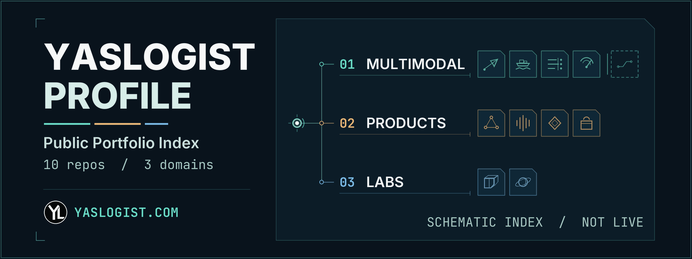
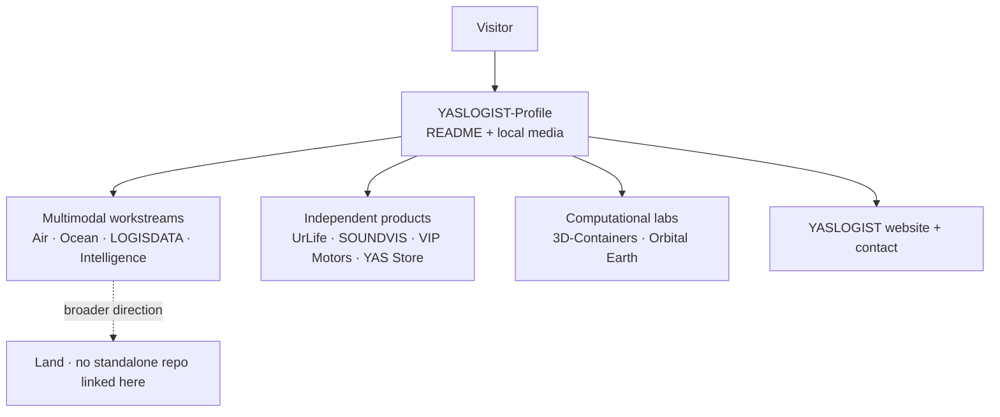

<div align="center">
  
</div>

<div align="center">

# YASLOGIST-Profile

**One index for logistics workstreams, independent products, and computational labs.**

A public portfolio by [YASLOGIST](https://www.yaslogist.com) · Engineering &amp; digital products · Cairo, Egypt

[Explore the work](#user-content-workstreams) · [How this repository works](#user-content-profile-repository) · [Official website](https://www.yaslogist.com)

<sub>The opening animation is a navigation schematic, not operational data. Prefer no motion? <a href="./assets/readme/profile-index.png">Open the static poster</a>.</sub>

</div>

## 01 / The profile

YASLOGIST explores multimodal logistics, data, visibility, and intelligence alongside independent digital products and creative engineering. **This repository is the portfolio entry point**, not a logistics application or a shared control room. The projects below keep their own identities, source code, and maturity; a line between them in the artwork represents a place in the index, not a software integration.

Public project descriptions and demos are not evidence of live feeds, commercial deployment, production integrations, or service levels. Follow a repository for its implementation, setup instructions, tests, and current limitations.

<a id="workstreams"></a>

## 02 / Multimodal workstreams

| Project · primary language | Public scope | Listed demo |
| :--- | :--- | :--- |
| **[YASLOGIST Air](https://github.com/YASLOGIST/air)** · TypeScript | Air-freight simulation cockpit for cargo planning, ULD fit, and CAI corridors. | [Air](https://air.yaslogist.me) |
| **[YASLOGIST Ocean](https://github.com/YASLOGIST/OCEAN-YASLOGIST)** · TypeScript | Sea-freight demo covering Egyptian gateway scenarios, cold-chain cases, and shipment handoffs. | [Ocean](https://ocean.yaslogist.me) |
| **[LOGISDATA](https://github.com/YASLOGIST/LOGISDATA)** · TypeScript | Interactive supply-chain audit and data-reconciliation control room. | [LOGISDATA](https://logisdata.vercel.app) |
| **[YASLOGIST Intelligence](https://github.com/YASLOGIST/yaslogist-intelligence)** · JavaScript | Regional threat and supply-chain intelligence dashboard. | [Intelligence](https://yaslogist-intelligence.vercel.app) |

**Land** is part of the broader multimodal direction; this profile does not link a standalone Land repository.

## 03 / Independent products

| Project · primary language | Public scope | Listed demo |
| :--- | :--- | :--- |
| **[UrLife](https://github.com/YASLOGIST/urlf-up)** · JavaScript | Collaboration platform concept connecting visionaries, builders, and enablers. | [UrLife](https://urlf-up.vercel.app) |
| **[SOUNDVIS](https://github.com/YASLOGIST/yaslogist-soundvis)** · TypeScript | Audio-reactive 3D visualizer and live VJ performance engine. | — |
| **[VIP Motors Atelier](https://github.com/YASLOGIST/vip-landing)** · JavaScript | Bilingual luxury-vehicle concierge landing experience. | — |
| **[YAS Store](https://github.com/YASLOGIST/as-store-v1yas-frontend)** · JavaScript | Shopify Hydrogen storefront with edge rendering, search, and commerce flows. | — |

## 04 / Computational labs

| Project · primary language | Public scope | Listed demo |
| :--- | :--- | :--- |
| **[3D-Containers](https://github.com/YASLOGIST/3D-Containers)** · TypeScript | Browser-based ULD workbench with profile-based geometry, procedural materials, and client-side GLB, OBJ, and STL export. | [3D-Containers](https://containers-one.vercel.app) |
| **[Orbital Earth](https://github.com/YASLOGIST/yastera)** · JavaScript | Three.js and GLSL planet-rendering experiment with a four-layer Earth, single-scattering atmosphere, ocean optics, and city detail, without baked scene lighting. | — |

The descriptions above summarize the linked repositories; they are not independent verification of their operational behavior. Demo links are listed project homepages, not monitored services, and availability is not guaranteed.

## 05 / How the index is organized

This is a **navigation diagram**, not a shared runtime architecture. The portfolio links to independent repositories; it does not move data between them.



To explore, choose a project above, then open its repository for source and project-specific instructions. Demos, where listed, are separate from this profile.

<a id="profile-repository"></a>

## 06 / Inside this repository

| Layer | What is here |
| :--- | :--- |
| **Content** | This README uses GitHub-flavored Markdown, supported HTML, and a Mermaid navigation diagram. |
| **Media** | A locally stored GIF, a static PNG, the existing YL mark and fonts, and earlier profile artwork. No JavaScript or video player is needed for the hero. |
| **Runtime** | No application package manifest, backend, API, database, environment variables, or dedicated deployment workflow is defined in this repository. GitHub renders the README; the linked repositories are separate. |
| **Build-time tools** | Python scripts generate artwork; `tools/verify_assets.py` and `tests/` check the repository. They are not part of the README's runtime. |
| **Automation** | `.github/workflows/verify.yml` runs the existing verifier and unit tests on pushes to `main`, pull requests, and manual dispatch. See the known test conflict below. |

```text
README.md                             portfolio content and navigation
assets/yaslogist-*.{gif,png}          retired artwork, kept but not displayed
assets/readme/profile-index.gif       animated opening
assets/readme/profile-index.png       static fallback
assets/readme/build_profile_index.py  new artwork generator and checks
assets/readme/profile-index.build.json  source and output hashes
assets/readme/yaslogist-mark.svg      existing YL mark master
assets/readme/fonts/                  existing Inter and JetBrains Mono fonts
assets/readme/scene.py                earlier globe artwork scene
assets/readme/build_hero.py           earlier GIF/PNG generator and build stamp
assets/readme/build_poster.py         earlier lightweight WebP generator
tools/verify_assets.py                existing README and earlier-art verifier
tests/                                mark, scene and verifier unit tests
```

<a id="artwork-and-checks"></a>

## 07 / Artwork &amp; local checks

The opening visual treats the profile as a **three-part index**. A selector travels the spine and highlights each category; the projects remain independent. It is pre-rendered, local artwork, not a live status display. The current GIF is **1920 × 720**, loops over **9 seconds**, and is about **1.06 MiB**; its [static poster](./assets/readme/profile-index.png) shows all three branches at once. The GIF may autoplay where supported; the poster is an explicit still alternative, not an automatic reduced-motion switch.

The [generator](./assets/readme/build_profile_index.py) uses Pillow, the bundled [fonts](./assets/readme/fonts/), and the repository's existing [YL SVG mark](./assets/readme/yaslogist-mark.svg), whose geometry is parsed by [`mark.py`](./assets/readme/mark.py). The [build stamp](./assets/readme/profile-index.build.json) records input and output hashes. `--check` decodes every GIF frame, checks duration, loop boundary, brightness changes, poster dimensions, and those hashes. The generator does not require network access after its dependencies are installed; rendering can vary across Pillow/FreeType versions.

### Get a local copy

There is no application to start or configure. To edit the profile or inspect its tools:

```bash
git clone https://github.com/YASLOGIST/YASLOGIST-Profile.git
cd YASLOGIST-Profile
```

### Build and validate the media

Python 3.11+ is used by the repository's CI. The new artwork generator needs Pillow; NumPy is also needed for the existing strict verifier and scene tests. One local setup is:

```bash
python3 -m venv ~/.venvs/yaslogist-profile
. ~/.venvs/yaslogist-profile/bin/activate
python -m pip install "Pillow>=10,<14" "numpy>=1.24,<3"

# Regenerate the opening GIF, poster, and their build stamp when editing its source.
python assets/readme/build_profile_index.py
python assets/readme/build_profile_index.py --check

# Existing checks: README paths, earlier artwork, mark geometry, and tests.
python tools/verify_assets.py --strict
python -m unittest discover -s tests -t . -v
python -m py_compile assets/readme/build_profile_index.py assets/readme/build_hero.py \
  assets/readme/build_poster.py assets/readme/scene.py assets/readme/mark.py \
  tools/verify_assets.py
git diff --check
```

**Known test conflict:** the existing `test_profile_opens_with_static_art_and_opt_in_motion` asserts that the older WebP is the first image and that no GIF is embedded. It already fails with an animated-first README, so the unit-test step in the existing workflow will fail until that expectation is updated. The test and workflow are not changed by this presentation. The existing verifier checks the earlier hero in detail and checks README asset paths, but **does not automatically run the new hero's `--check`**.

<details>
<summary><strong>Earlier artwork and its tooling</strong></summary>

The previous illustrative globe remains available as a <a href="./assets/readme/yaslogist-hero.gif">10-second GIF</a>, [PNG](./assets/readme/yaslogist-hero.png), and [lightweight WebP](./assets/readme/yaslogist-hero.webp), along with its [signal divider](./assets/readme/yaslogist-signal.gif) and [workstream plate](./assets/platform-map.svg). These are conceptual portfolio illustrations, not live logistics data or a shared runtime.

[`scene.py`](./assets/readme/scene.py) and [`build_hero.py`](./assets/readme/build_hero.py) generate the 1920 × 720, 200-frame globe GIF and PNG, plus [`yaslogist-hero.build.json`](./assets/readme/yaslogist-hero.build.json), which records the earlier artwork's source and output hashes. [`build_poster.py`](./assets/readme/build_poster.py) derives the WebP from the PNG and records its source hash. To rebuild those earlier assets with the same Python environment, run:

```bash
python assets/readme/build_hero.py
python assets/readme/build_poster.py
```

The existing verifier checks that earlier GIF's structure, timing, palette, loop and build stamp, as well as the WebP's relationship to its PNG source. It can be run without Pillow for structural checks, but `--strict` requires the image and scene dependencies. `python tools/verify_assets.py --probe` also re-renders a frame for an informational comparison; pixel differences between renderers are not a pass/fail freshness test. The old builder's `--stamp-only` option is appropriate only for edits that cannot change pixels.

</details>

## 08 / Scope &amp; status

- **Present here:** portfolio content, local visual assets, asset generators, verification tools, and tests.
- **Described, not independently verified here:** capabilities and demos of the linked public projects. Each repository is the source for its own setup and current maturity.
- **Vision:** Land is a broader workstream direction, not a standalone repository linked by this profile.
- **Not asserted:** live operational feeds, uptime, commercial deployment, or integrations between these projects. This repository does not ingest shipment events or call project APIs at runtime.

---

<div align="center">
  <a href="https://www.yaslogist.com" title="Visit the official YASLOGIST website">
    
  </a>
  <br />
  <a href="https://www.yaslogist.com">Official website</a> ·
  <a href="https://github.com/YASLOGIST?tab=repositories">Public repositories</a> ·
  <a href="mailto:support@yaslogist.com">Email YASLOGIST</a>
  <br /><br />
  <b>YASLOGIST</b><br />
  <sub>MOVE SMARTER. SEE FURTHER.</sub><br />
  <sub>Engineering and digital products · Cairo, Egypt</sub>
</div>
